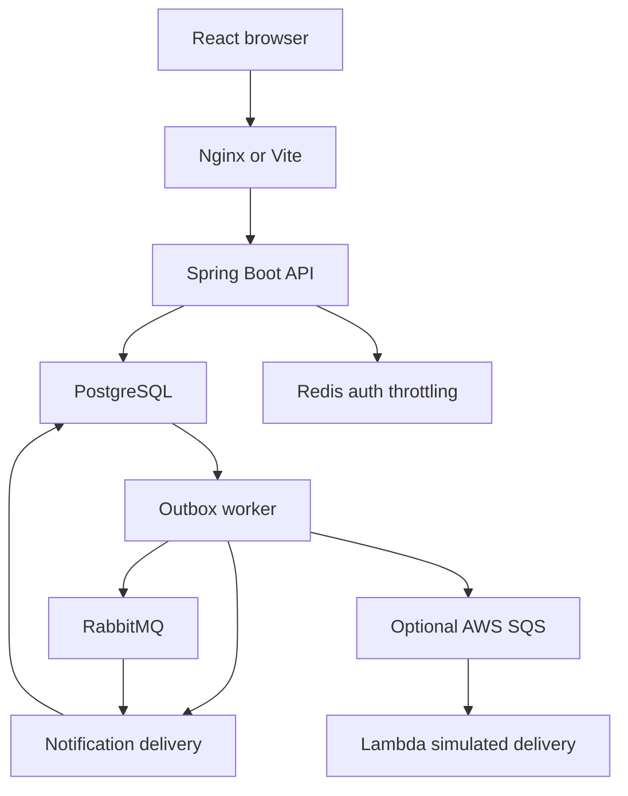
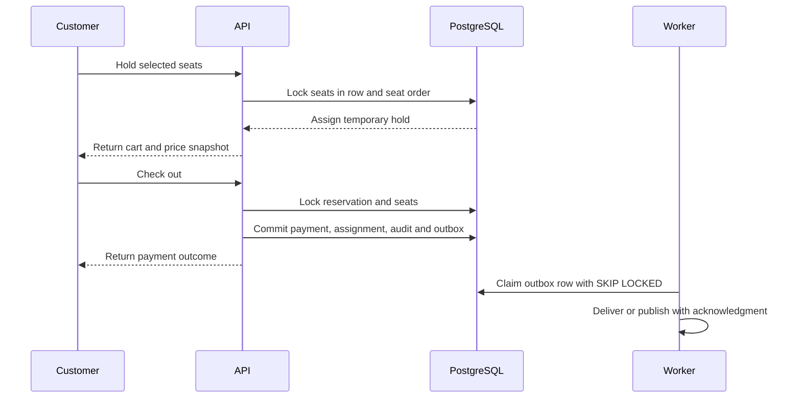

# Architecture

The Spring Boot API is a modular monolith. PostgreSQL stores authoritative inventory and reservations. A separate worker runs from the same build. Compose uses Redis for authentication throttling and RabbitMQ for notifications. Native startup uses the PostgreSQL outbox as its transport.

A booking is a seat assignment with no expiration. Checkout and cancellation serialize on the reservation row, verify ownership, and then lock assigned seats. Declines and cancellations release seats. Historical order items remain independent of inventory ownership. Reads treat expired holds as available before cleanup. The browser refreshes the map every two seconds.

JPA optimistic versions protect event edits. A venue row serializes layout changes and event creation. Layout geometry is a numbered rectangle and locks once an event references it. Prices are snapshotted at hold time.

Rabbit publisher confirms and mandatory routing prevent marking the outbox sent before broker acknowledgment. A crash can still cause redelivery. Local delivery deduplicates by message UUID. SMTP can send a duplicate if the worker dies after the SMTP server accepts the message and before the delivery transaction commits. Lambda emits simulated delivery IDs to CloudWatch, where duplicate log entries are possible.

The worker retries publication with exponential delays and marks exhaustion as dead. RabbitMQ consumers retry and dead-letter rejected messages. SQS uses its queue redrive policy. The admin endpoint reports database outbox counts. Broker dead letters are observed separately.
